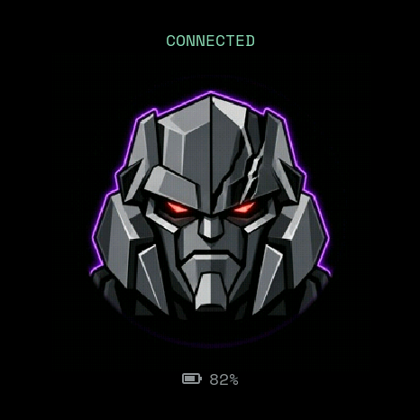
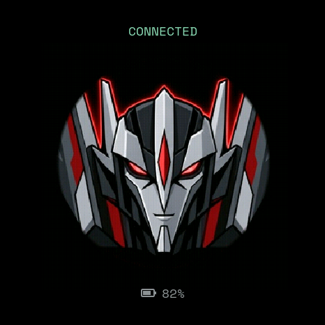

# StopWatch AgentBezel based on M5Stack C152 StopWatch Dev Kit（ESP32-S3R8）

[简体中文](README.zh-CN.md)

**Stopwatch AgentBezel C152** is an independent, unofficial, open-source
four-screen control surface for the **M5Stack StopWatch Dev Kit C152**:
interactive robot Home, Codex Micro compatibility, DeepSeek Harness navigation
and super.engineering project controls, with a local quota dashboard, optional
USB microphone and opt-in task notifications.

Codex Micro compatibility is experimental and undocumented. The multi-screen
experience requires matching source-built USB-mic firmware and Companion.
Validation covers one local setup, not every desktop-app version.

## Current version at a glance

The [2026-10-24 deployment and acceptance record](docs/superpowers/plans/2026-10-24-trim-home-verification.md)
covers firmware source `6d27164` and Companion **0.1.4 build19**. The explicitly
selected USB-mic/Home-IMU application is **3,381,136 bytes**, SHA-256
`8308e3537da854a353d1bfbce9eca2d99034ea4f83231af17890c244432d6703`.

- Four-screen cycle: **Home → Codex → DSH → Super → Home**.
- Home has **13 images**: default Bumblebee portrait, six Autobots and six
  Decepticons. Jazz, Hot Rod, Soundwave and Skywarp are retired from the live
  roster; historical source images remain preserved.
- Hermes workspace, notification collection and OPEN routes are retired.
  Supported notification sources are **Codex, DSH and Super**. See the
  [retirement note](#retired-hermes-integration).
- The current notification UI retains its **90px Home badge**, single reading
  layer and separate filled **BACK / OPEN** buttons. Codex/DSH model display
  prefers the last reply's model, falls back to session configuration, and
  displays no configuration prefix.
- App-only deployment, independent application readback and an unchanged first
  **64 KiB** protected region passed. HID/IMU checks and a **2.005333-second,
  48 kHz, 16-bit mono** USB input capture passed; the temporary recording was deleted.
- The user accepted the complete cycle, Home switching/tilt, Agent controls,
  supported-source synthetic notifications, browsing, independent BACK and real
  Codex exact-task OPEN. Return-to-Home speed meets the user's expectation;
  physical latency, power and long-duration stability were not measured.

Foreground handling preserves the selected watch page. A foreground app is
ready immediately; a missing or background app waits for a center tap to launch
or activate. Closing the last DSH/Super window returns to **TAP TO OPEN**;
a slowly reopened window becomes operational when ready. CODEX retains its
original dashboard in every state. Released page swipes use a 200ms cooldown;
existing release gating, dedicated navigation and launch protections remain.

The separately selected [Home IMU pilot](docs/HOME_IMU_PILOT.md) uses
`m5stack-stopwatch-home-imu`; normal release environments do not enable it.
Earlier static trials, image hashes and touch/haptic acceptance belong to their
recorded versions. The [Home interaction history](docs/HOME_HERO_INTERACTION.md),
[foreground-control diagnosis](docs/CONTROL_AVAILABILITY.zh-CN.md) and
[paced-navigation history](docs/superpowers/plans/2026-09-12-paced-navigation-verification.md)
are historical evidence, not complete retests of this image.

## Robot Home and three workspaces

Boot, reconnect and Companion startup select Home without activating a Mac app.
Mac foreground changes preserve Home. The live roster is:

| Group | Images |
| --- | --- |
| Default | Bumblebee portrait |
| Autobots (six) | Bumblebee full body, Optimus Prime, Wheeljack, Hound, Ironhide, Ratchet |
| Decepticons (six) | Megatron, Starscream, Shockwave, Thundercracker, Blitzwing, Astrotrain |

Swipe up for a uniformly selected Autobot or down for a Decepticon. Within the
same faction, the current role is excluded; from the portrait or opposite
faction, all six are eligible. Right returns to the Bumblebee portrait. Valid
selections retain the 320ms transition and one short haptic, including offline.
Held motion cannot repeat. Leaving Home resets the next visit to Bumblebee.

Touch inside x=64..402/y=64..398 gives immediate 3% compression. Release within
500ms without a swipe plays a silent 600ms character response and one 30ms
haptic. New taps interrupt the current response. Leaving the portrait area or
reaching the 52px swipe threshold cancels the tap. The first sleeping-screen
touch only wakes it; leaving Home, sleep or power confirmation cancels animation.
Existing long-hold power controls and accepted quiet haptics remain.

The renderer retains the bounded idle-image cache across awake Agent/Home
returns and releases response buffers. Cold boot or an evicted sleep cache still
requires decoding. This improves the return path without establishing a physical
latency measurement. Portrait interactions request no speech or Mac action;
USB microphone and Codex completion chime behavior remain unchanged. An awake,
online Home left swipe gives one gesture haptic; offline left remains silent.
Status and battery are real device inputs.

The public gallery shows four selected previews; the full roster is listed
above. These are native framebuffer previews, not hardware photographs.

<table>
  <tr><th>Bumblebee portrait (default)</th><th>Optimus Prime</th><th>Megatron</th><th>Starscream</th></tr>
  <tr>
    <td width="25%"></td>
    <td width="25%"></td>
    <td width="25%"></td>
    <td width="25%"></td>
  </tr>
</table>

Built-in illustrations are unofficial fan artwork embedded as JPEG assets,
not official licensed artwork or network-fetched media. Retired source artwork
is retained for provenance and is not part of the current live roster.

<table>
  <tr><th>Codex Micro</th><th>DSH</th><th>super.engineering</th></tr>
  <tr>
    <td width="33%"></td>
    <td width="33%"></td>
    <td width="33%"></td>
  </tr>
</table>

**Swipe left to cycle: Home → Codex / ChatGPT → DSH → Super → Home.**
The Codex / ChatGPT entry uses `com.openai.codex` and counts as one target.
Left selects a page; center launches or activates a waiting app. Returning Home
leaves the Mac foreground unchanged. Failed targets are not skipped: center
retries, while left continues the cycle.

| Input | Robot Home | Codex Micro | DSH | Super |
| --- | --- | --- | --- | --- |
| Left physical / right physical | No action¹ | Push to talk / Voice Chat | No action¹ | No action¹ |
| Center tap | Compression / character response + short haptic | Launch/retry when waiting; Send when active | Launch/retry when waiting; no action when active | Launch/retry when waiting; no action when active |
| Swipe left | Select Codex | Select DSH | Select Super | Enter Home |
| Swipe up | Random Autobot (exclude current in faction) | Existing app mapping | Previous thread | Previous project |
| Swipe down | Random Decepticon (exclude current in faction) | Existing app mapping | Next thread | Next project |
| Swipe right | Bumblebee portrait | Existing app mapping | Chat / Trajectory | Next session Tab |
| Power controls | Desk sleep / Travel Mode | Same | Same | Same |

¹ Directional screens and device-side isolation require the explicitly chosen
matching `usb-mic` firmware. The default wireless image remains a Codex panel.
Companion directions require a real `--watch` process.

## Codex Micro workspace

The default dashboard shows Agent state, weekly Codex allowance, reset
countdown, battery and charging/Dock state, and whether Codex, BLE, and quota
sync are healthy. A completed Agent turns green and plays a soft completion
chime. The left physical button is Push to talk, the right button is Voice
Chat, the center dial is Send, and up/down/right remain configurable in ChatGPT Desktop; left is reserved for
workspace cycling while the Companion runs in real watch mode. Physical buttons and touch gestures use
haptics.

The normal center dial uses four balanced rows: connection status, remaining
quota, reset countdown and battery. It omits the redundant `WEEKLY LEFT` label;
diagnostic states retain messages such as `SYNC STALE` and `WAITING CODEX`.

The compatible `Codex Micro` BLE HID channel carries controls. The local quota
companion uses a separate, project-owned BLE GATT service, so the watch never
stores an OpenAI token. The installed ChatGPT Desktop version used during
development exposed one Mic key rather than separate `ACT10` and `ACT11`
assignments: the right button intentionally sends configurable `ACT09`
(`Command Key 4`), not `ACT11`.

On battery, the display dims after two minutes and enters desk sleep after five;
Dock Mode extends those intervals to ten and thirty minutes. Desk sleep keeps
BLE alerts alive. Double-click the red power button for firmware-confirmed
Travel Mode shutdown; power button or USB wakes it. A six-second center hold is
a deliberately slower Travel Mode fallback with a missed-alert warning. Physical
power switching soak testing is still pending, so timings and wake behavior are
experimental until that checklist is complete.

## DeepSeek Harness workspace

The **DSH** page uses the exact app bundle `com.deepseek.dsh`, not a browser
URL or CLI. Left from Codex selects it; left from DSH selects SUPER.
The CYCLE / PREV / NEXT / VIEW circles share SUPER's geometry and palette.
Up/down select the previous/next existing thread in sidebar order, continuing
across project boundaries; right switches the main Chat / Trajectory view.
When active, center and physical action buttons remain disabled. When absent,
center launches/retries; waiting/opening/error pages allow only left navigation
and eligible center launches.

Install the optional [DeepSeek navigation plugin](deepseek-plugin/README.md)
only after reviewing its compatibility and privacy limits. The installed Harness
has no native commands for these operations. Companion sends fixed
`Control-Option-Up/Down/Right` only to its revalidated foreground process; the
plugin registers those shortcuts. This navigation path does not read session
content; optional notification collectors have a separate content boundary. The browser plugin uses structural row IDs locally, never titles,
message text, drafts or credentials. It opens only existing threads, never
creates one. Trajectory must already be available; ambiguous or unsupported
UI state fails closed. Use plugin 0.1.1; deprecated 0.1.0 must not be installed.
Earlier navigation acceptance belongs to the historical versions in the
[DSH change record](docs/DEEPSEEK_BLINK.md).

App activation failure does not skip to another target.
It shares the 5-second heartbeat and 15-second lease/fallback with other work
pages, and requires the matching new Companion. Quota still belongs to Codex;
no DeepSeek credentials or session content are read.

## super.engineering workspace

Identify the running app by current bundle `engineering.super.app` or legacy
bundle `com.zarifpour.superconductor`; Companion launches the current bundle.
Configure these app
shortcuts: Previous Project = `Control-Option-Up`, Next Project =
`Control-Option-Down`, Next Tab = `Control-Option-Right`.
Up/down/right are sent only to that exact foreground process. Left returns to
Home without changing the Mac foreground.

## Retired Hermes integration

Hermes Desktop is no longer a selectable workspace or notification source.
Its collector and OPEN routes are removed; old Hermes queue entries are migrated
out without changing supported-source IDs. Legacy workspace parsing remains for
compatibility and cannot make Hermes replace the selected page.
The [original Hermes acceptance](docs/superpowers/plans/2026-09-04-hermes-open-physical-acceptance.md)
is historical documentation only; follow the
[current deployment record](docs/superpowers/plans/2026-10-24-trim-home-verification.md)
for the supported roster and cycle.

## Shared workspace setup and screen behavior

1. Install the three target desktop apps. Assign each to a normal macOS Space
   manually using **Dock → Options → Assign To → This Desktop** if desired.
   The Companion activates the selected target; it does not create/enumerate
   Spaces or choose windows by content.
2. Enable Input Monitoring and Accessibility for the installed
   `CodexWatchCompanion.app`; retain Bluetooth permission for quota sync.
3. Leave **Analog stick left** unbound in ChatGPT's controller settings.
   Preserve the existing up/down/right mappings. Restart the original
   Companion LaunchAgent after any permission change.
4. Install matching Companion and explicitly chosen USB-mic firmware only
   after source validation, backups and exact-port flash confirmation.

DSH/SUPER share four solid circular indicators and a thin central status
ring, using the Codex black background and Space Mono font family. The ring
shows connectivity, not quota or progress. Pending launch pages dim up/down/right
while retaining left navigation and the existing center input region.
The battery icon and percentage are centered together beneath the title and
connection status, including unknown and three-digit percentages.
Every accepted local swipe picks four distinct colors from a 12-color pool;
each direction changes from its previous color. Text switches between light and
dark for contrast; accepted swipes briefly dim the indicator.
Palette feedback has its own 800ms cooldown; redraw, heartbeat, quota updates
and Dock/Command-Tab changes do not recolor. This is local input feedback, not
proof that the Mac accepted a shortcut.

Notification counts and text use antialiased Space Mono. Supported source
labels are Codex, DSH and Super. See [task notifications](#optional-task-notifications)
for the single-layer display, model provenance and privacy boundary.

All pages preserve the selection made on the watch. Foreground loss puts the
selected Agent into its center-to-activate state. Mode heartbeats run every
5 seconds with a 15-second connection-owned lease. Losing the lease or owner
connection restores Home. Foreground updates never wake the
screen. Disabled short taps/physical controls do not wake directional screens;
a genuine swipe wakes without also issuing an unseen action. Center long-hold
and red-button power behavior remain available.

DSH/SUPER block Agent, Send and ChatGPT microphone/voice button actions;
mode transitions release held controls and suppress stale completion notices.
The USB microphone endpoint remains available. MainActor routing revalidates
the exact foreground PID/bundle before fixed process-targeted key delivery;
no global key injection or application-content reading is used.

### Validation status and checks for your installation

The [current acceptance record](docs/superpowers/plans/2026-10-24-trim-home-verification.md)
separates automated checks, device readback and user-observed behavior. Full
SwiftPM XCTest was unavailable on the validation host; standalone Swift
regressions are not a complete XCTest run. Earlier linked records apply to their
own images.

For each new installation, verify the full four-screen cycle, cold app launch,
failure/no-skip, app-specific directions, assigned Spaces, sleep/wake, input
isolation, no background ChatGPT actions, lease fallback, reconnect, USB input,
quota and automatic startup. Verify notifications separately if enabled. Builds
and native previews alone do not establish C152 hardware success.

## Recommended installation

This is a source-build project: no prebuilt macOS app, DMG, or PKG is
distributed. The recommended path is to open this repository locally in Codex
on the Bluetooth-capable Mac that will pair with the C152. It requires macOS
14+, Swift 5.10+ (Xcode 15.3 Command Line Tools+), PlatformIO Core, a
data-capable USB-C cable for the first flash, and a signed-in ChatGPT Desktop
with Codex Micro support. This port supports **M5Stack StopWatch Dev Kit, SKU
C152** only; other M5Stack devices are unsupported.

Choose the intended experience before building:

| Experience | Firmware | What you get |
| --- | --- | --- |
| Four-screen AgentBezel described above | Explicitly choose `pio run -d usb-mic` + matching source-built Companion | Interactive hero Home, Codex, DSH, SUPER, input-only USB microphone |
| Basic Codex-only compatibility | `pio run -e m5stack-stopwatch` | Codex dashboard and BLE controls, Mac-selected microphone; no multi-screen Home/selector |

The physically accepted tilt-enabled variant additionally requires explicit
selection of `m5stack-stopwatch-home-imu` in the isolated `usb-mic` project; see
the [IMU guide](docs/HOME_IMU_PILOT.md). The normal USB-mic target omits IMU.

The following prompt **explicitly selects the four-screen USB-mic variant**.
For Codex-only installation, use the basic target in the manual section instead;
do not mix the two variants' startup checks. Connect the C152, never guess its
serial port, and paste this into Codex:

```text
Install the four-screen AgentBezel experience on my M5Stack StopWatch Dev Kit C152.
I choose the isolated USB-mic firmware and matching Companion, including Home,
Codex, DSH and SUPER. Home taps play silent character responses with short haptics.

Read AGENTS.md and README.md completely before acting. Work through the setup
autonomously, but follow these safety rules:

1. Start with read-only checks. Confirm macOS, the C152 target, available build
   tools, and the exact newly connected serial device.
2. Build the selected USB-mic variant with `pio run -d usb-mic`. Explain its
   dependency downloads and disk cost; do not enable unrelated audio experiments.
3. Explain any missing dependency before installing it. Never ask me for an
   OpenAI API key, login cookie, access token, or other credential.
4. Show me the official M5Stack factory-recovery link and build the firmware
   before attempting an upload.
5. Immediately before flashing, report the exact /dev/cu.* port you resolved
   and ask me to confirm that one destructive device action.
6. After flashing and restarting the watch, verify Codex StopWatch Mic USB input
   and BLE/HID independently. This variant has no normal serial READY console.
7. Help me grant ChatGPT Input Monitoring and configure ChatGPT Desktop: left
   button = Push to talk, Command Key 4 = Toggle voice chat, center = Send, and
   keep up/down/right configurable and leave left unbound for watch-mode cycling.
8. Build the Swift quota companion from source. Use demo discovery to find this
   Mac's CoreBluetooth UUID, then bind real quota writes to that exact device.
9. If I approve automatic startup, create the local app wrapper and LaunchAgent
   only on this Mac. Keep generated paths, UUIDs, logs, and app files out of Git.
10. Guide me through Companion Input Monitoring/Accessibility, SUPER shortcuts
    and optional manual Space assignment. Do not silently change permissions or
    app settings. Keep any existing LaunchAgent configuration and private binding.
11. Verify four-screen cycling, character selection, DSH/SUPER launch and
    navigation, Codex controls, input isolation, sleep/reconnect,
    quota and a short local microphone recording. Delete that recording afterward.
12. Keep public builds silent unless I supply authorized local audio. Never upload
    private speech. Record only physically observed results as passed, and preserve
    matched firmware/Companion backups before replacement.
```

The repository's [AGENTS.md](AGENTS.md) provides durable installation and
privacy boundaries. Claude Code and other local coding agents can follow the
same instructions, but Codex is the documented default.

## macOS permissions and app configuration

Codex handles terminal work; the user still approves missing tools and the
exact flash, pairs **Codex Micro** in **System Settings > Bluetooth**, and
allows **ChatGPT** in **System Settings > Privacy & Security > Input
Monitoring** before quitting and reopening ChatGPT. Configure the actions in
**ChatGPT Desktop > Settings > Codex Micro**. The base installation needs
Bluetooth access for the locally built companion; the optional
DSH/SUPER phase additionally needs Input Monitoring and Accessibility
for `CodexWatchCompanion.app`.

Build the quota companion from source, run demo discovery, and bind real writes
only to the CoreBluetooth UUID printed by that Mac. Keep the `--watch` process
running unless automatic startup is installed. With approval, a locally built
wrapper and per-user LaunchAgent can provide automatic startup; generated app
files, paths, UUIDs, and logs remain local. The LaunchAgent template identity is
`io.github.codex-micro-stopwatch.companion` and the executable remains
`codex-watch-companion`.

After an image change, verify BLE connectivity and HID enumeration separately;
a Bluetooth connection alone does not prove that controls are attached. Only
re-pair the StopWatch if troubleshooting establishes a stale pairing problem;
do not repeatedly delete working pairings or reset system permissions. Keep a
real Codex Micro's pairing record, but disconnect or power it off while
validating this port: one active Micro is supported at a time.

## Optional USB microphone

The default `m5stack-stopwatch` image uses the Mac microphone. Users who
explicitly choose the isolated `usb-mic` build can expose the StopWatch as
**Codex StopWatch Mic**: 48 kHz, 16-bit, mono, input-only USB Audio. It has no
USB speaker/output endpoint. BLE controls and the dashboard remain included;
the local completion chime plays only while the Mac is not streaming microphone
audio. Keep USB connected while recording, select **Codex StopWatch Mic** in
**System Settings > Sound > Input**, and keep Push to talk and Voice Chat
actions on Bluetooth while audio samples travel over USB.

Build this separate target with `pio run -d usb-mic`; explain its first-build
toolchain download, time, and disk cost before starting. Follow the same
factory-recovery and exact-port confirmation rules. Afterward, do not expect
the default serial READY marker: verify the selected **Codex StopWatch Mic**
input, verify BLE/HID separately, and make a short local recording test. Do
not commit recordings, device identifiers, or local paths.

## Privacy and architecture

Swift `CodexWatchCompanion` uses the user's existing local signed-in context to
start a local Codex App Server and read `account/rateLimits/read`. Only quota
percentage and reset countdown travel over the private quota GATT service to
the explicitly bound watch; authentication stays on the Mac.

In a real `--watch` run, workspace control sends fixed `home`, `codex`, `deepseek`
and `super` display modes and fixed launch/navigation enums over vendor HID
Report ID 6. Foreground PID/bundle and limited Accessibility window handles/roles
are checked locally; workspace navigation does not read titles, task text,
window contents or application settings. It does not use global key injection,
private Space APIs, shell commands or AppleScript for navigation.

Opt-in [task notifications](#optional-task-notifications) have a separate content
boundary: local adapters may read native task/session metadata and bounded reply
excerpts and send the selected title, model, time and excerpt to the watch.
Exact OPEN routing retains native identifiers on the Mac. Notification content
is user data; real events, route inventories, logs and task text must stay outside
Git. No API key, token, account credential or microphone audio belongs in the
firmware or BLE payloads. No cloud relay is used by this integration.

Device identifiers, usernames, home-directory paths and logs remain local and
must never be committed. BLE uses platform Just Works pairing without a passkey;
use a trusted environment and remove stale pairing when ownership changes.
See the [companion documentation](companion/README.md),
[GATT contract](docs/COMPANION_PROTOCOL.md) and
[private notification bridge](companion/TASK_NOTIFICATIONS.md).

## Manual build and flash

The Codex-assisted flow is recommended. Maintainers can use
[PlatformIO Core](https://docs.platformio.org/en/latest/core/index.html):

```sh
pio run -e m5stack-stopwatch
pio device list
```

Identify the exact serial device that appeared for the connected C152. Build
first, read M5Stack's [official StopWatch factory-recovery guide](https://docs.m5stack.com/en/guide/restore_factory/stopwatch),
and only then flash the resolved port after explicit confirmation:

```sh
pio run -e m5stack-stopwatch --target upload --upload-port /dev/cu.YOUR_C152_PORT
```

Never copy a port from another user's documentation. A successful default boot
prints `CODEX_MICRO_STOPWATCH_READY`; verify it against that same port:

```sh
python3 scripts/serial_probe.py /dev/cu.YOUR_C152_PORT --seconds 30 \
  --expect CODEX_MICRO_STOPWATCH_READY
```

For the optional USB-mic image, use the same recovery and exact-port safeguards:

```sh
pio run -d usb-mic
pio run -d usb-mic -e m5stack-stopwatch-usb-mic --target upload \
  --upload-port /dev/cu.YOUR_C152_PORT
```

The USB-mic image replaces normal USB serial with audio, so no
`CODEX_MICRO_STOPWATCH_READY` is expected. Later updates can use the
companion's encrypted `--enter-bootloader` command, then must rediscover and
confirm the newly enumerated port; M5Stack's manual recovery gesture remains
the fallback.

To run the quota companion manually:

```sh
cd companion
swift build -c release

# Demo data only; prints the UUID seen by this Mac.
.build/release/codex-watch-companion --demo --verbose

# Replace the placeholder locally. Never commit the resulting UUID.
.build/release/codex-watch-companion \
  --device-id YOUR_COREBLUETOOTH_UUID --watch --interval 60
```

## Optional task notifications

The [native adapters](notifications/README.md) connect opt-in completion and
navigation-only approval/input alerts through the
[private Companion bridge](companion/TASK_NOTIFICATIONS.md). Supported entry
points are Codex notify, the separate DeepSeek Host observer and SUPER lifecycle
CLI. They require explicit installation or execution; Hermes is retired.

Home retains the 90px notification badge. Read-only notices use one reading
layer with independent filled **BACK** and **OPEN** buttons; body taps do not
open a redundant detail page. Up/down browse notices. BACK returns independently
of OPEN; OPEN requests navigation on the Mac and does not answer the request.
Codex/DSH model/time uses the last reply's model first, then session configuration,
with no configuration prefix. Missing model information is not invented.

All current native adapters use `canDecide:false`. Reading, dismissing and OPEN
never approve, reject or answer a native request. Only a verified native route
requests exact task navigation; otherwise OPEN activates the app. Current
physical acceptance includes supported-source synthetic notices and a real
Codex exact-task OPEN; it does not establish exact DSH/Super task routing.
Real events, IDs, logs and reply excerpts must remain outside the repository.

The [2026-10-24 acceptance](docs/superpowers/plans/2026-10-24-trim-home-verification.md)
is the current baseline. Earlier records document their own versions:
[initial integration](docs/TASK_NOTIFICATIONS_RELEASE_20261020.md),
[content V2](docs/NOTIFICATION_CONTENT_V2_UPDATE_20261022.md),
[DSH content parity](docs/DSH_NOTIFICATION_CONTENT_20261023.md),
[reply-model priority](docs/NOTIFICATION_REPLY_MODEL_20261023.md),
[build18 deployment](docs/NOTIFICATION_REPLY_MODEL_UPDATE_20261023.md) and
[first single-layer revision](docs/NOTIFICATION_SINGLE_LAYER_20261023.md).
Their intermediate candidate/deployment status does not describe the current
build19 acceptance.

## Troubleshooting

### The C152 does not appear as a serial device

- Try a known data-capable USB-C cable and another port.
- Disconnect other development boards, list ports again, and reconnect only the
  C152.
- If installed firmware cannot boot, follow M5Stack's official download-mode
  and factory-recovery instructions.

### Codex Micro does not appear in Bluetooth settings

- Restart the watch and scan again.
- If a stale pairing is confirmed, re-pair only this StopWatch; avoid repeated
  pairing resets without checking the BLE and HID layers first.
- For the default image, confirm `CODEX_MICRO_STOPWATCH_READY` over serial. For
  USB-mic, verify its audio interface and BLE/HID independently.

### ChatGPT sees the Micro but controls do nothing

- Allow ChatGPT in Input Monitoring, then quit and reopen it.
- Disconnect any other active Codex Micro.
- Temporarily quit keyboard remappers or security tools that may claim or block
  HID, then reconnect.

### The right button does not open Voice Chat

Assign **Command Key 4** to **Toggle voice chat** in ChatGPT Desktop. The
button sends `ACT09`, not `ACT11`.

### The screen says `SYNCING MAC` or quota is stale

- Confirm the companion runs on the paired Mac.
- Re-run demo discovery and bind the exact UUID printed on that Mac.
- Do not copy a UUID from another computer: CoreBluetooth identifiers are local
  to the host.

### Optional workspace navigation does not work

- Check DSH bundle `com.deepseek.dsh` and SUPER bundle `engineering.super.app`
  (legacy `com.zarifpour.superconductor`), physical-keyboard shortcuts and the
  optional [DSH navigation plugin](deepseek-plugin/README.md).
- Confirm Input Monitoring, Accessibility and the installed Companion
  **0.1.4 build19** identity. A running app does not prove its window is ready;
  select its page and tap center when waiting.
- Match Companion and firmware. The supported cycle has four pages and returns
  from Super to Home; Hermes must not appear. Use the
  [current acceptance record](docs/superpowers/plans/2026-10-24-trim-home-verification.md)
  when diagnosing a mixed-version installation.
- For notification OPEN, check the selected source's adapter and route. Only
  verified routes open an exact task; fallback app activation is expected.
  BACK is a separate control and must not dispatch OPEN.

## Acknowledgements, license, and trademarks

This repository belongs to an open-source implementation lineage:

1. [`imliubo/codex-micro-4-core2`](https://github.com/imliubo/codex-micro-4-core2)
   established an earlier Codex Micro compatibility implementation for M5Stack
   Core2 and is the implementation reference for portions of the BLE vendor-HID
   compatibility layer.
2. [`digitsisyph/codex-micro-stopwatch`](https://github.com/digitsisyph/codex-micro-stopwatch)
   adapts portions of that BLE layer for the M5Stack StopWatch C152, then adds
   the StopWatch UI, power behavior, quota companion, and optional USB
   microphone. It is the direct codebase on which this repository builds.
3. **Stopwatch AgentBezel C152** continues the StopWatch codebase with Codex Micro,
   DSH and super.engineering workspaces, foreground Companion integration,
   dedicated directional displays, robot Home, optional task notifications and
   USB microphone priority handling. Historical releases also included Hermes.

This is an implementation lineage, not a claim that the repositories are
runtime package dependencies or officially affiliated projects. Each later
step depends on, cites, and extends earlier open-source work. Please preserve the
original notices when redistributing, describe your own changes clearly, cite
the project you build upon, contribute generally useful fixes upstream where
appropriate, and treat maintainers and contributors with respect. Healthy open
source is shared stewardship: we maintain compatibility and the commons
together.

The adapted code and this project's changes are distributed under the MIT
License with applicable attribution preserved in [LICENSE](LICENSE) and
[NOTICE.md](NOTICE.md). Space Mono remains under the SIL Open Font License 1.1
in `assets/fonts/OFL.txt`.

OpenAI documentation for the original device is available at
[Codex Micro](https://learn.chatgpt.com/docs/features/codex-micro), and the
local client interface used by the companion is documented under
[Codex App Server](https://learn.chatgpt.com/docs/app-server).

Names and marks are used only to identify compatibility. See [NOTICE.md](NOTICE.md)
for attribution, protocol, security, warranty, and trademark notices.
