# StopWatch AgentBezel based on M5Stack C152 StopWatch Dev Kit（ESP32-S3R8）

[简体中文](README.zh-CN.md)

An explicitly selected [Home IMU pilot](docs/HOME_IMU_PILOT.md) explores pickup,
tilt and settling via the `m5stack-stopwatch-home-imu` environment. It is disabled
in normal release environments. Synthetic tests and native previews do not
establish physical false-trigger rates, response latency or power consumption.
The first pilot (`fe28100`, application hash prefix `5bdd3ed9026a`) was written to app0 on 2026-10-16 with verified application and
protected-metadata checks. The user confirmed natural direction in the initial
three cycles and normal feedback in a follow-up trial, then chose to stop before
the 30-cycle protocol. Its exact action count is unconfirmed, so no hit rate is
reported. A separate 600.80-second desk-still trial recorded zero unintended
pickups and zero sensor-read errors. Interference scenarios, physical P95 latency
and power remain unmeasured; this is a pilot, not full acceptance.
The continuity version (`43d8e91`, application hash prefix `6cc50998db76`) was
written to app0 on 2026-10-16 with verified application and protected-metadata
checks, followed by a successful reboot, IMU diagnostics and a 3.008-second USB
microphone check. The user confirmed that pickup-to-tilt tracking feels more
responsive with noticeably less lag. A separate new-version 601.22-second
desk-still trial, using only start/end diagnostics, recorded zero unintended
pickups and zero new sensor-read errors.
It uses a 60ms elapsed-time
acceleration filter, IMU redraw cadence measured from render start, and 600ms
Held-to-Resting stillness. Initial/recovery calibration remains 1500ms, with the
accepted roll/pitch mapping and input guards preserved. More frequent redraws
may increase power use. The automatic-wake duplicate-frame integration bug is
also fixed. Fixed-count hit rate, interference scenarios, physical onset latency
and power remain unmeasured; the first pilot's 600.80-second result is kept
separate from this version's static trial.

The swipe-resume version (`df5480c`, application hash prefix `c83363fcc22e`)
was written to app0 on 2026-10-16 with application digest and protected-metadata
checks passing. Reboot, calibrated IMU diagnostics and a 3.008-second USB
microphone check passed. It preserves calibrated state only across successful
Home up/down/right character swipes, retaining touch/haptic suppression and
250ms quiet time. The user initially reported continuous tilt lag, then reported
better behavior on the same firmware without another flash or parameter change.
The user then explicitly accepted immediate tracking after up/down/right
character swipes. Keep this firmware; no additional tuning was applied.
The user chose to skip this version's static retest. Quantified false-trigger
rate, physical onset latency and power remain unmeasured.

**Stopwatch AgentBezel C152** is an independent, unofficial, open-source
five-screen control surface for the **M5Stack StopWatch Dev Kit C152**:
Codex Micro compatibility, DeepSeek Harness activation, super.engineering project controls, and Hermes
Desktop session controls, plus an interactive robot Home, local quota dashboard
and optional USB microphone.

Codex Micro compatibility is experimental and undocumented. Runtime names,
pairing identities, audio selection and the local Companion identity remain
unchanged. The five-screen experience requires matching source-built USB-mic
firmware and Companion. Validation covers one local setup, not every app version.

## Current version at a glance

Companion build14 unifies foreground handling for all four Agent pages. Left
selects a page without activating a background app. A foreground target is ready
immediately; a missing or background target waits for a center tap to launch or
activate and reopen a closed last window. Mac foreground changes preserve the selected page. This Companion release
originally used build9; the historical nine-image Home firmware and the locally
deployed 17-page Home faction version are distinguished below. DSH, SUPER and Hermes
check for an actual application window; closing the last window returns to
**TAP TO OPEN** on the next one-second check. A slow reopen automatically becomes
operational when its real foreground window is ready, including after a timeout.
See the
[control diagnosis and acceptance record](docs/CONTROL_AVAILABILITY.zh-CN.md).

- Five screens: robot Home → Codex / ChatGPT → DSH → SUPER → HERMES → Home.
- Current local clarity revision: `24676b8` / `298f1c7b3ef4` was flashed to
  app0 on 2026-10-17, with independent ROM verification, unchanged protected
  bytes, HID/IMU diagnostics and a short USB microphone capture passing. It
  corrects Decepticon downsampling aliasing; the user confirmed noticeably
  improved clarity and normal interaction. The earlier Home acceptance below
  belongs to the prior image. Quantitative latency, static false-trigger rate
  and power remain unmeasured for this revision.
- Quiet-haptics tuning: the first image `d30708d3b27d` was flashed and verified,
  but the user reported weak, intermittently imperceptible feedback. The new
  adjusted image `c2a6549ac574` was then flashed; feel and sound were accepted,
  while the user reported absent IMU interaction. Static diagnostics remain
  Calibrating with about 6.5dps gyro output, above the 4dps stillness limit.
  The next unflashed candidate follows the user's request: Home/ordinary touch
  and swipe use 76/255 for 30ms. Buttons retain 176/255 for 24ms, wake 20ms and
  travel-off 24ms. Pending frames wait for motor stop before rendering;
  Home's first response frame precedes its pulse, including overlapping taps.
  Ordinary touch keeps the 55ms host-key pulse, stopping the motor after 30ms.
  Travel-off retains the 550ms prompt wait. The accepted image `298f1c7b3ef4`
  remains the accepted rollback. The tuned candidate's startup reliability,
  physical pulse width, feel and noise have not been measured;
  simulated boundaries do not establish quieter physical operation.
- Home: 17 pages (Bumblebee portrait, eight Autobots, eight Decepticons).
  Up selects an Autobot; down selects a Decepticon; right returns to the portrait.
  Same-faction random selection excludes the current role; cross-faction selection
  includes all eight. Short taps retain the silent 600ms response, immediate 3%
  compression and one 25ms haptic. Source `81f91fef`, application hash prefix
  `0aaa4606a3c3`, was flashed to app0 on 2026-10-16; independent ROM verification,
  unchanged protected bytes, HID/IMU diagnostics and USB microphone capture passed.
  The user confirmed correct switching/tap responses and acceptable tilt tracking.
  This is qualitative acceptance; static false triggers, physical latency and power
  were not measured for this version. The historical nine-image USB-mic application from `4b1b6e9` was flashed
  on 2026-10-14, app0 only. Application digest/protected metadata, reboot, USB
  input-only audio, BLE HID status RPC and a short microphone capture passed;
  the user confirmed its Home interactions normal. Subsequent IMU swipe-resume
  acceptance above belongs to `df5480c` / `c83363fcc22e`. Quantified latency,
  frame rate, motor timing and PSRAM headroom remain unmeasured.
- DSH: the same four-triangle layout as SUPER. Up/down navigate existing
  threads in sidebar order across project boundaries; right switches Chat /
  Trajectory. Requires the optional navigation plugin; center and physical
  action buttons remain disabled when active. The title is exactly `DSH`
  using the same font as SUPER/HERMES, fitted within the center panel.
- When a harness is not running, left selects its waiting page without launching;
  center explicitly launches/retries. Opening rejects repeated taps. Existing
  active controls remain. CODEX always retains the original dashboard UI in all
  states: no four-triangle replacement or new visual prompts, only the pending
  center-launch behavior changes. All four pages use the same foreground/center activation policy.
- Dedicated navigation retains 350ms release-gated cooldown; cycling/launch
  retains 800ms protection and key sequences retain 30ms pacing.

See [change details and validation](docs/DEEPSEEK_BLINK.md).
**The DSH label update was flashed on 2026-10-12; the user confirmed the title and up/down/right controls normal.** Historical
[Home acceptance](docs/superpowers/plans/2026-09-21-home-equal-spacing-half-volume.md)
and [navigation acceptance](docs/superpowers/plans/2026-09-12-paced-navigation-verification.md)
cover earlier images; the current change record documents the DSH acceptance scope.

## Robot Home and four workspaces

Home requires matching source-built Companion and USB-mic firmware. Boot,
reconnect and Companion startup select Home without activating a Mac app.
Home stays selected even when the Mac foreground changes. The 17-page Home includes
Bumblebee portrait (default); eight Autobots (Bumblebee full body, Optimus Prime,
Jazz, Hot Rod, Wheeljack, Hound, Ironhide, Ratchet); and eight Decepticons (Megatron,
Starscream, Soundwave, Shockwave, Thundercracker, Skywarp, Blitzwing, Astrotrain). Touch down inside
x=64..402/y=64..398 for immediate 3% compression; release within
500ms without a swipe to play a silent 600ms character response and one 30ms haptic
in the unflashed candidate (25ms in the accepted rollback). New taps
interrupt the current reaction instead of being ignored. Moving outside the
portrait area or reaching the 52px swipe threshold cancels the tap.
Swipe up to select uniformly among the eight Autobots, or down among the eight
Decepticons. Within the same faction the current role is excluded; from the
portrait or opposite faction all eight are eligible. Right selects the Bumblebee
portrait with no random draw. Each valid selection retains the 320ms transition
and one 30ms candidate haptic (40ms in the accepted rollback), even
offline. Held motion cannot repeat. Left retains the workspace cycle. The first
sleeping-screen touch only wakes the display. Leaving Home, sleep or power
confirmation cancels the reaction; existing long-hold power controls remain.
All portraits remain without a decorative boundary circle. The firmware caches
seventeen idle RGB565 sprites and at most two response sprites for the current
role in PSRAM (at most 19 slots / 3,420,000 pixel bytes, excluding other memory).
Role switches evict the old response bank; repeated taps on the same role reuse
it. New Decepticons use one response pose for 600ms with a small native transform;
existing Autobot motion remains unchanged.
The idle bank can use one reusable buffer; action allocation failure preserves
the idle figure and motion without per-frame decoding. Home
redraws only for animation or state changes. The same cached renderer drives
native previews; build/preview results do not establish C152 response latency.
The locally deployed 17-page version (`81f91fef` / `0aaa4606a3c3`) passed the
user's switching, tap and continuous IMU-follow trial. Asset/cache size and native
pixels do not measure latency or power. Earlier IMU/static results remain attached
to their historical versions; no new static trial was performed.
No speech or Mac action is requested by portrait interaction. USB microphone and
Codex completion chime behavior are unchanged. See
[Home hero interaction and validation](docs/HOME_HERO_INTERACTION.md).
[Historical native preview of the nine deployed responses](artifacts/robot-home-responses.png).
An awake Home left swipe with a ready Companion link gives the same single
vibration as other workspace swipes; offline left remains silent. This is gesture
feedback, not confirmation of Mac activation.
Status and battery are real device inputs, not the preview's sample values.

<table>
  <tr><th>Bumblebee portrait (default)</th><th>Bumblebee full body</th><th>Optimus Prime</th><th>Jazz</th></tr>
  <tr>
    <td width="25%">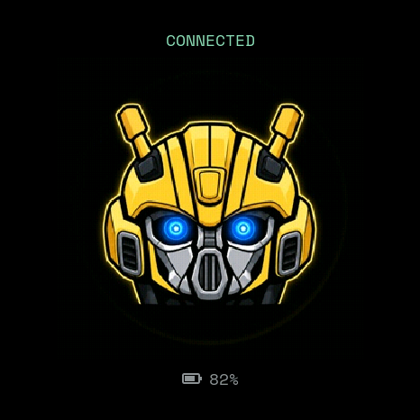</td>
    <td width="25%">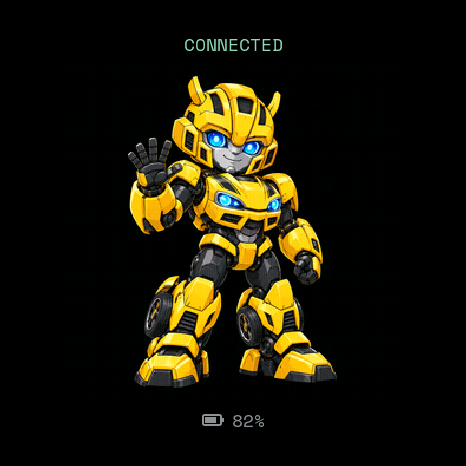</td>
    <td width="25%">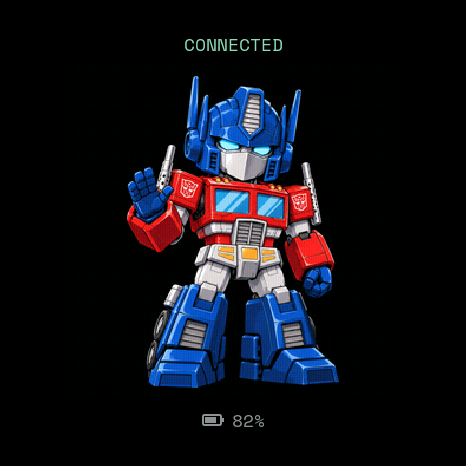</td>
    <td width="25%">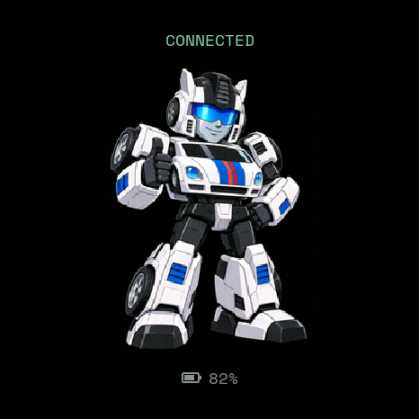</td>
  </tr>
  <tr><th>Hot Rod</th><th>Wheeljack</th><th>Hound</th><th>Ironhide</th></tr>
  <tr>
    <td width="25%">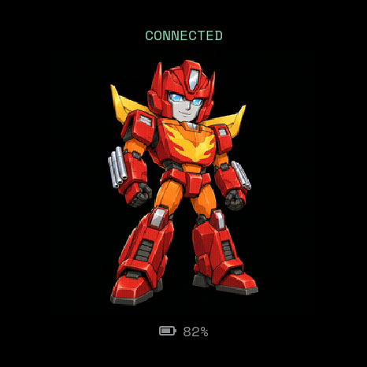</td>
    <td width="25%">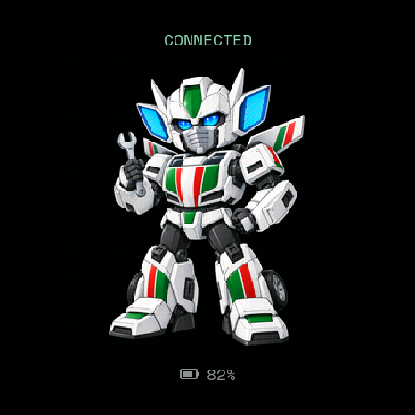</td>
    <td width="25%">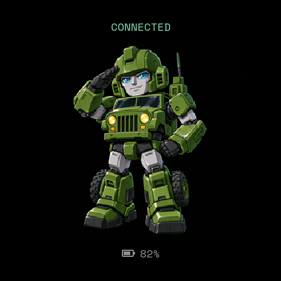</td>
    <td width="25%">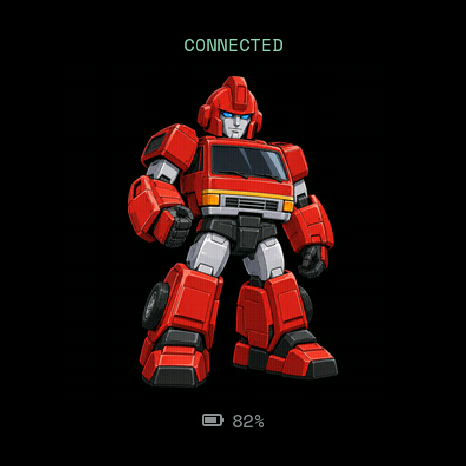</td>
  </tr>
  <tr><th>Ratchet</th><th></th><th></th><th></th></tr>
  <tr><td width="25%">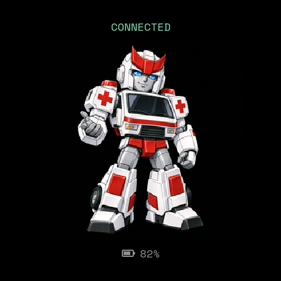</td><td width="25%"></td><td width="25%"></td><td width="25%"></td></tr>
</table>

The preserved portrait and eight built-in imagegen full-body illustrations are
unofficial fan artwork embedded in firmware as baseline JPEG assets. They are
not official licensed artwork or network-fetched media.
Leaving Home resets the next visit to Bumblebee.

<table>
  <tr><th>Codex Micro</th><th>DSH</th><th>super.engineering</th><th>Hermes Desktop</th></tr>
  <tr>
    <td width="25%"></td>
    <td width="25%">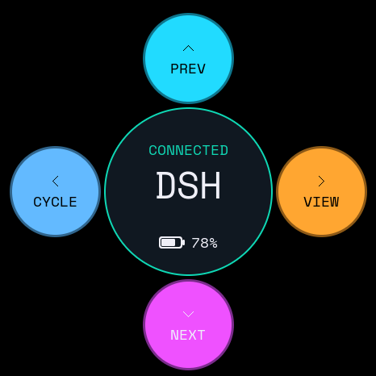</td>
    <td width="25%">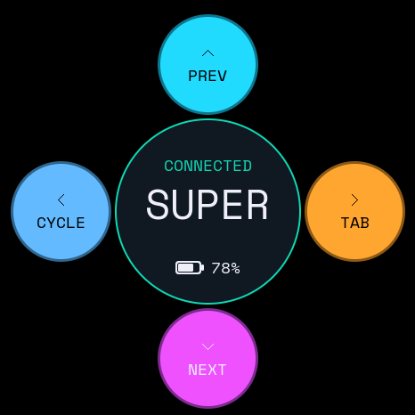</td>
    <td width="25%">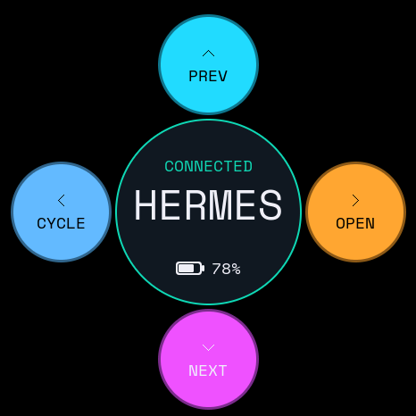</td>
  </tr>
</table>

These are native framebuffer design previews, not hardware photographs.

**Swipe left to cycle: Home → Codex / ChatGPT → DSH → SUPER → HERMES → Home.**
The current Codex / ChatGPT entry uses `com.openai.codex`; it is one target,
not two. Left selects Codex; if absent, only center launches it. A foreground target is ready immediately; a running background target
waits for a center tap to activate. Returning Home leaves the Mac unchanged. Missing or rejected
targets show their waiting/error page; center retries, left continues the cycle. The former “return to previous
app” behavior is replaced by this fixed cycle.

| Input | Robot Home | Codex Micro | DSH | SUPER | HERMES |
| --- | --- | --- | --- | --- | --- |
| Left physical / right physical | No action¹ | Push to talk / Voice Chat | No action¹ | No action¹ | No action¹ |
| Center tap | Press compression / character response + short haptic | Launch/retry when waiting; Send when active | Launch/retry when waiting; no action when active | Launch/retry when waiting; no action when active | Launch/retry when waiting; no action when active |
| Swipe left | Select Codex | Select DSH | Select SUPER | Select HERMES | Enter Home |
| Swipe up | Random Autobot (exclude current in faction) | Existing app mapping | Previous thread | Previous project | Browse previous session |
| Swipe down | Random Decepticon (exclude current in faction) | Existing app mapping | Next thread | Next project | Browse next session |
| Swipe right | Fixed Bumblebee portrait | Existing app mapping | Chat / Trajectory | Next session Tab | Open owned selection; otherwise no action |
| Power controls | Desk sleep / Travel Mode | Same | Same | Same | Same |

¹ Directional screens and device-side isolation require the explicitly chosen
matching `usb-mic` firmware. The default wireless image remains a Codex panel.
Companion direction handling requires a real `--watch` process.

## Codex Micro workspace

The default dashboard shows Agent state, weekly Codex allowance, reset
countdown, battery and charging/Dock state, and whether Codex, BLE, and quota
sync are healthy. A completed Agent turns green and plays a soft completion
chime. The left physical button is Push to talk, the right button is Voice
Chat, the center dial is Send, and up/down/right remain configurable in ChatGPT Desktop; left is reserved for
workspace cycling while the Companion runs in real watch mode. Physical buttons and touch gestures use
haptics.

The normal center dial uses four balanced rows: connection status, remaining
quota, reset countdown and battery. It omits the redundant `WEEKLY LEFT` label;
diagnostic states retain messages such as `SYNC STALE` and `WAITING CODEX`.

The compatible `Codex Micro` BLE HID channel carries controls. The local quota
companion uses a separate, project-owned BLE GATT service, so the watch never
stores an OpenAI token. The installed ChatGPT Desktop version used during
development exposed one Mic key rather than separate `ACT10` and `ACT11`
assignments: the right button intentionally sends configurable `ACT09`
(`Command Key 4`), not `ACT11`.

On battery, the display dims after two minutes and enters desk sleep after five;
Dock Mode extends those intervals to ten and thirty minutes. Desk sleep keeps
BLE alerts alive. Double-click the red power button for firmware-confirmed
Travel Mode shutdown; power button or USB wakes it. A six-second center hold is
a deliberately slower Travel Mode fallback with a missed-alert warning. Physical
power switching soak testing is still pending, so timings and wake behavior are
experimental until that checklist is complete.

## DeepSeek Harness workspace

The **DSH** page uses the exact app bundle `com.deepseek.dsh`, not a browser
URL or CLI. Left from Codex selects it; left from DSH selects SUPER.
The CYCLE / PREV / NEXT / VIEW triangles share SUPER's geometry and palette.
Up/down select the previous/next existing thread in sidebar order, continuing
across project boundaries; right switches the main Chat / Trajectory view.
When active, center and physical action buttons remain disabled. When absent,
center launches/retries; waiting/opening/error pages allow only left navigation
and eligible center launches.

Install the optional [DeepSeek navigation plugin](deepseek-plugin/README.md)
only after reviewing its compatibility and privacy limits. The installed Harness
has no native commands for these operations. Companion sends fixed
`Control-Option-Up/Down/Right` only to its revalidated foreground process; the
plugin registers those shortcuts. Neither firmware nor Companion reads session
content. The browser plugin uses structural row IDs locally, never titles,
message text, drafts or credentials. It opens only existing threads, never
creates one. Trajectory must already be available; ambiguous or unsupported
UI state fails closed. Plugin 0.1.1 with build8 passed the preceding user-observed
physical navigation acceptance; never install deprecated 0.1.0. The deployed
random swipes and the new Home character responses were accepted by the user.

 App activation failure does not skip to another target.
It shares the 5-second heartbeat and 15-second lease/fallback with other work
pages, and requires the matching new Companion. Quota still belongs to Codex;
no DeepSeek credentials or session content are read.

## super.engineering workspace

Identify the running app by current bundle `engineering.super.app` or legacy
bundle `com.zarifpour.superconductor`; Companion launches the current bundle.
Configure these app
shortcuts: Previous Project = `Control-Option-Up`, Next Project =
`Control-Option-Down`, Next Tab = `Control-Option-Right`.
Up/down/right are sent only to that exact foreground process. Left advances to
Hermes; it does not return to an arbitrary previous app.

## Hermes Desktop workspace

Use the **Companion built from this revision** with matching five-screen USB-mic firmware.
Dedicated SUPER/HERMES events use `host.workspace_navigation`, not Codex's
native radial events; keep Codex up/down/right bindings and verify no background
Codex action. Install/roll back compatible components together. Build/commit
metadata and opt-in diagnostics are described in the [Companion guide](companion/README.md).

Left from SUPER selects HERMES. If already foreground, navigation is ready;
otherwise **TAP TO OPEN** waits without launching or activating Hermes. Tap inside the center square to open the
exact Desktop app. **OPENING** permits one outstanding request; actual Hermes
foreground confirmation enables the existing directions below. Rejection or a
3-second timeout shows **TAP TO RETRY**, with no automatic open request. A later
live check of the selected foreground window clears the retry state when ready.
Up/down/right
are ignored while waiting, opening or retrying; left always exits to Home.
Dock/Command-Tab switching preserves the selected page; a background target
returns to its center-to-activate state. Reconnect and Companion restart select Home. All work pages, including Codex, renew
every 5 seconds and fall back to Home after a 15-second lease expires. A Home
acknowledgment is required before stale work-page heartbeats can be accepted.
Mode changes never wake the display. Install and roll back the matched pair;
see the [Home verification record](docs/superpowers/plans/2026-09-15-robot-home-verification.md).

A tap must start and end inside the square, last less than 500ms and never
cross the swipe threshold. It shares the 800ms host cooldown with directions.
The first sleeping-screen tap only wakes; a second tap may open Hermes. Active
Hermes center taps do nothing. Long-hold power controls remain available.

Desktop auto-launch and display heartbeat are separate: the Companion's
5-second HID heartbeat never launches an app. A separately installed
`ai.hermes.desktop` LaunchAgent with `KeepAlive` may repeatedly relaunch the
client after exit. On the approved local setup that job was backed up, unloaded
and disabled, retaining its plist for recovery. Gateway/dashboard were left
unchanged. Do not disable other services or assume this job exists on every Mac.
See [deployment and rollback](companion/README.md#hermes-desktop-launch-policy).

Central launch uses `NSWorkspace.openApplication` even when Hermes is already
running, with activation enabled and new-instance creation disabled. For the
exact foreground Hermes process, Accessibility requests focus on its focused/
main window without reading content or titles. The three dedicated Agent pages
also check bounded AX application window handles and roles locally. This addresses
the case where the process was foreground but navigation required a title-bar
click. The user confirmed restored interactions; API success alone is not proof
of a visible/focused window on another installation.

<table><tr><th>Selected</th><th>Request pending</th><th>Retry on tap</th></tr><tr>
<td></td>
<td></td>
<td>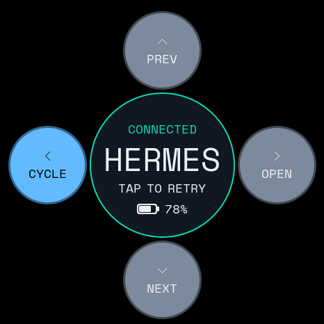</td>
</tr></table>

Use the exact native app bundle `com.nousresearch.hermes`, not a CLI, web
dashboard or installer. Up sends `Control-Shift-Tab`, down sends
`Control-Tab`, retaining the [native Desktop browsing shortcuts](https://hermes-agent.nousresearch.com/docs/user-guide/desktop#windows-tabs--panes).
When the central session picker is visible, browse with up/down and swipe right
to open the highlighted session. The Companion retains its own Control press
across up/down gestures; right releases it with no modifier flags. Without an
owned selection, right is a no-op. The tested Hermes 0.17.0 picker commits on
Control release; no Return or Command-T is sent, so right is not New Tab.
Verify the behavior with a physical keyboard on your Hermes version before
installation. Native browsing can depend on the focused Tab region; it is not
project-tree-order navigation. No Hermes plugin or source extension is required.
The Companion does not inspect the picker, read/change Hermes settings or
session data, or retry confirmation. Both the keyboard action and physical
browse/open gestures were confirmed on the tested installation, including
repeat-right and no-picker checks without new sessions, sent drafts or a stuck
Control modifier. Repeat acceptance after changing Hermes versions.

## Shared workspace setup and screen behavior

1. Install the four target desktop apps. Assign each to a normal macOS Space
   manually using **Dock → Options → Assign To → This Desktop** if desired.
   The Companion activates apps and restores focus to Hermes's focused/main
   window; it does not create/enumerate Spaces or choose among window contents.
2. Enable Input Monitoring and Accessibility for the installed
   `CodexWatchCompanion.app`; retain Bluetooth permission for quota sync.
3. Leave **Analog stick left** unbound in ChatGPT's controller settings.
   Preserve the existing up/down/right mappings. Restart the original
   Companion LaunchAgent after any permission change.
4. Install matching Companion and explicitly chosen USB-mic firmware only
   after source validation, backups and exact-port flash confirmation.

SUPER/HERMES share four outward triangles, with no independent center outline.
The battery icon and percentage are centered together beneath the title and
connection status, including unknown and three-digit percentages.
Every accepted local swipe picks four distinct colors from a 12-color pool;
each direction changes from its previous color. Text colors remain stable.
Palette feedback has its own 800ms cooldown; redraw, heartbeat, quota updates
and Dock/Command-Tab changes do not recolor. This is local input feedback, not
proof that the Mac accepted a shortcut.

All pages preserve the selection made on the watch. Foreground loss puts the
selected Agent into its center-to-activate state. Mode heartbeats run every
5 seconds with a 15-second connection-owned lease. Losing the lease or owner
connection restores Home. Foreground updates never wake the
screen. Disabled short taps/physical controls do not wake directional screens;
a genuine swipe wakes without also issuing an unseen action. Center long-hold
and red-button power behavior remain available.

SUPER/HERMES block Agent, Send and ChatGPT microphone/voice button actions;
mode transitions release held controls and suppress stale completion notices.
The USB microphone endpoint remains available. MainActor routing revalidates
the exact foreground PID/bundle before fixed process-targeted key delivery;
no global key injection or application-content reading is used.

### Validation status and checks for your installation

The [latest Home record](docs/superpowers/plans/2026-09-21-home-equal-spacing-half-volume.md)
covers the user-observed final layout, lower central voice, character selection
and four-screen controls. The [paced-navigation record](docs/superpowers/plans/2026-09-12-paced-navigation-verification.md)
covers earlier navigation, background-window restoration and microphone checks;
the [original three-workspace record](docs/superpowers/plans/2026-09-04-hermes-open-physical-acceptance.md)
remains historical. Do not interpret them as a complete rerun on every later image.
The latest follow-up did not repeat microphone recording or long-duration soak tests.
Full XCTest remains unavailable on the development host because its Command
Line Tools lack XCTest; the Swift harness is not a complete XCTest run.

For each new installation, verify one full left-swipe cycle, cold app launch, failure/no-skip, assigned
Spaces, all app-specific directions, 350ms navigation/800ms cycle-launch gating, random colors, sleep/wake,
input isolation, no background ChatGPT actions, 15-second fallback, reconnect,
USB microphone capture, quota updates and original automatic startup.
Builds and native previews alone do not establish C152 hardware success.

## Recommended installation

This is a source-build project: no prebuilt macOS app, DMG, or PKG is
distributed. The recommended path is to open this repository locally in Codex
on the Bluetooth-capable Mac that will pair with the C152. It requires macOS
14+, Swift 5.10+ (Xcode 15.3 Command Line Tools+), PlatformIO Core, a
data-capable USB-C cable for the first flash, and a signed-in ChatGPT Desktop
with Codex Micro support. This port supports **M5Stack StopWatch Dev Kit, SKU
C152** only; other M5Stack devices are unsupported.

Choose the intended experience before building:

| Experience | Firmware | What you get |
| --- | --- | --- |
| Five-screen AgentBezel described above | Explicitly choose `pio run -d usb-mic` + matching source-built Companion | Interactive hero Home, Codex, DSH, SUPER, HERMES, input-only USB microphone |
| Basic Codex-only compatibility | `pio run -e m5stack-stopwatch` | Codex dashboard and BLE controls, Mac-selected microphone; no multi-screen Home/selector |

The following prompt **explicitly selects the five-screen USB-mic variant**.
For Codex-only installation, use the basic target in the manual section instead;
do not mix the two variants' startup checks. Connect the C152, never guess its
serial port, and paste this into Codex:

```text
Install the five-screen AgentBezel experience on my M5Stack StopWatch Dev Kit C152.
I choose the isolated USB-mic firmware and matching Companion, including Home,
Codex, DSH, SUPER and HERMES. Home taps play silent character responses with short haptics.

Read AGENTS.md and README.md completely before acting. Work through the setup
autonomously, but follow these safety rules:

1. Start with read-only checks. Confirm macOS, the C152 target, available build
   tools, and the exact newly connected serial device.
2. Build the selected USB-mic variant with `pio run -d usb-mic`. Explain its
   dependency downloads and disk cost; do not enable unrelated audio experiments.
3. Explain any missing dependency before installing it. Never ask me for an
   OpenAI API key, login cookie, access token, or other credential.
4. Show me the official M5Stack factory-recovery link and build the firmware
   before attempting an upload.
5. Immediately before flashing, report the exact /dev/cu.* port you resolved
   and ask me to confirm that one destructive device action.
6. After flashing and restarting the watch, verify Codex StopWatch Mic USB input
   and BLE/HID independently. This variant has no normal serial READY console.
7. Help me grant ChatGPT Input Monitoring and configure ChatGPT Desktop: left
   button = Push to talk, Command Key 4 = Toggle voice chat, center = Send, and
   keep up/down/right configurable and leave left unbound for watch-mode cycling.
8. Build the Swift quota companion from source. Use demo discovery to find this
   Mac's CoreBluetooth UUID, then bind real quota writes to that exact device.
9. If I approve automatic startup, create the local app wrapper and LaunchAgent
   only on this Mac. Keep generated paths, UUIDs, logs, and app files out of Git.
10. Guide me through Companion Input Monitoring/Accessibility, SUPER shortcuts
    and optional manual Space assignment. Do not silently change permissions or
    app settings. Keep any existing LaunchAgent configuration and private binding.
11. Verify five-screen cycling, character selection, Hermes central launch and
    navigation, SUPER controls, Codex controls, input isolation, sleep/reconnect,
    quota and a short local microphone recording. Delete that recording afterward.
12. Keep public builds silent unless I supply authorized local audio. Never upload
    private speech. Record only physically observed results as passed, and preserve
    matched firmware/Companion backups before replacement.
```

The repository's [AGENTS.md](AGENTS.md) provides durable installation and
privacy boundaries. Claude Code and other local coding agents can follow the
same instructions, but Codex is the documented default.

## macOS permissions and app configuration

Codex handles terminal work; the user still approves missing tools and the
exact flash, pairs **Codex Micro** in **System Settings > Bluetooth**, and
allows **ChatGPT** in **System Settings > Privacy & Security > Input
Monitoring** before quitting and reopening ChatGPT. Configure the actions in
**ChatGPT Desktop > Settings > Codex Micro**. The base installation needs
Bluetooth access for the locally built companion; the optional
SUPER/HERMES phase additionally needs Input Monitoring and Accessibility
for `CodexWatchCompanion.app`.

Build the quota companion from source, run demo discovery, and bind real writes
only to the CoreBluetooth UUID printed by that Mac. Keep the `--watch` process
running unless automatic startup is installed. With approval, a locally built
wrapper and per-user LaunchAgent can provide automatic startup; generated app
files, paths, UUIDs, and logs remain local. The LaunchAgent template identity is
`io.github.codex-micro-stopwatch.companion` and the executable remains
`codex-watch-companion`.

After an image change, verify BLE connectivity and HID enumeration separately;
a Bluetooth connection alone does not prove that controls are attached. Only
re-pair the StopWatch if troubleshooting establishes a stale pairing problem;
do not repeatedly delete working pairings or reset system permissions. Keep a
real Codex Micro's pairing record, but disconnect or power it off while
validating this port: one active Micro is supported at a time.

## Optional USB microphone

The default `m5stack-stopwatch` image uses the Mac microphone. Users who
explicitly choose the isolated `usb-mic` build can expose the StopWatch as
**Codex StopWatch Mic**: 48 kHz, 16-bit, mono, input-only USB Audio. It has no
USB speaker/output endpoint. BLE controls and the dashboard remain included;
the local completion chime plays only while the Mac is not streaming microphone
audio. Keep USB connected while recording, select **Codex StopWatch Mic** in
**System Settings > Sound > Input**, and keep Push to talk and Voice Chat
actions on Bluetooth while audio samples travel over USB.

Build this separate target with `pio run -d usb-mic`; explain its first-build
toolchain download, time, and disk cost before starting. Follow the same
factory-recovery and exact-port confirmation rules. Afterward, do not expect
the default serial READY marker: verify the selected **Codex StopWatch Mic**
input, verify BLE/HID separately, and make a short local recording test. Do
not commit recordings, device identifiers, or local paths.

## Privacy and architecture

The Swift `CodexWatchCompanion` starts a local Codex App Server with the
user's existing signed-in context and reads `account/rateLimits/read`. It sends
only remaining percentage and reset countdown over the project-owned quota
GATT service to the explicitly bound watch. The compatible HID interface does
not include account rate limits.

In a real `--watch` run, the optional workspace integration additionally sends
only fixed `home`/`codex`/`deepseek`/`super`/`hermes` display modes and optional Hermes
`idle`/`opening`/`error` state over
vendor HID Report ID 6; the watch's center action is the fixed `open_hermes` enum.
Dedicated directions carry only fixed workspace/direction/phase enums on that
same HID transport, not project or session data.
It does not send API keys, tokens, account identifiers, prompts, task text,
audio, project/session/window/Space metadata, or user content. It does not
scrape UI, use a cloud relay, inspect keyboard text, invoke shell commands or
AppleScript, use private Space APIs, or inspect super.engineering or Hermes settings.
Hermes central launch has one narrow Accessibility exception: focused/main
window handles and focus state are used locally to raise/focus the exact process's
window. No window title, content or window list is read or sent to the watch.

Device MAC addresses, CoreBluetooth UUIDs, usernames, home-directory paths,
and logs are local installation data and must never be committed. BLE pairing
uses the platform's Just Works flow without passkey authentication: use the
project in a trusted environment and remove stale pairings when a Mac or watch
changes owner. See [the companion documentation](companion/README.md) and the
[GATT contract](docs/COMPANION_PROTOCOL.md).

## Manual build and flash

The Codex-assisted flow is recommended. Maintainers can use
[PlatformIO Core](https://docs.platformio.org/en/latest/core/index.html):

```sh
pio run -e m5stack-stopwatch
pio device list
```

Identify the exact serial device that appeared for the connected C152. Build
first, read M5Stack's [official StopWatch factory-recovery guide](https://docs.m5stack.com/en/guide/restore_factory/stopwatch),
and only then flash the resolved port after explicit confirmation:

```sh
pio run -e m5stack-stopwatch --target upload --upload-port /dev/cu.YOUR_C152_PORT
```

Never copy a port from another user's documentation. A successful default boot
prints `CODEX_MICRO_STOPWATCH_READY`; verify it against that same port:

```sh
python3 scripts/serial_probe.py /dev/cu.YOUR_C152_PORT --seconds 30 \
  --expect CODEX_MICRO_STOPWATCH_READY
```

For the optional USB-mic image, use the same recovery and exact-port safeguards:

```sh
pio run -d usb-mic
pio run -d usb-mic -e m5stack-stopwatch-usb-mic --target upload \
  --upload-port /dev/cu.YOUR_C152_PORT
```

The USB-mic image replaces normal USB serial with audio, so no
`CODEX_MICRO_STOPWATCH_READY` is expected. Later updates can use the
companion's encrypted `--enter-bootloader` command, then must rediscover and
confirm the newly enumerated port; M5Stack's manual recovery gesture remains
the fallback.

To run the quota companion manually:

```sh
cd companion
swift build -c release

# Demo data only; prints the UUID seen by this Mac.
.build/release/codex-watch-companion --demo --verbose

# Replace the placeholder locally. Never commit the resulting UUID.
.build/release/codex-watch-companion \
  --device-id YOUR_COREBLUETOOTH_UUID --watch --interval 60
```

## Troubleshooting

### The C152 does not appear as a serial device

- Try a known data-capable USB-C cable and another port.
- Disconnect other development boards, list ports again, and reconnect only the
  C152.
- If installed firmware cannot boot, follow M5Stack's official download-mode
  and factory-recovery instructions.

### Codex Micro does not appear in Bluetooth settings

- Restart the watch and scan again.
- If a stale pairing is confirmed, re-pair only this StopWatch; avoid repeated
  pairing resets without checking the BLE and HID layers first.
- For the default image, confirm `CODEX_MICRO_STOPWATCH_READY` over serial. For
  USB-mic, verify its audio interface and BLE/HID independently.

### ChatGPT sees the Micro but controls do nothing

- Allow ChatGPT in Input Monitoring, then quit and reopen it.
- Disconnect any other active Codex Micro.
- Temporarily quit keyboard remappers or security tools that may claim or block
  HID, then reconnect.

### The right button does not open Voice Chat

Assign **Command Key 4** to **Toggle voice chat** in ChatGPT Desktop. The
button sends `ACT09`, not `ACT11`.

### The screen says `SYNCING MAC` or quota is stale

- Confirm the companion runs on the paired Mac.
- Re-run demo discovery and bind the exact UUID printed on that Mac.
- Do not copy a UUID from another computer: CoreBluetooth identifiers are local
  to the host.

### Optional workspace navigation does not work

- Confirm the SUPER foreground bundle is `engineering.super.app` or legacy
  `com.zarifpour.superconductor`, HERMES is `com.nousresearch.hermes`, the corresponding
  fixed shortcuts work from the physical keyboard, and Accessibility is enabled
  for `CodexWatchCompanion.app`.
- Input Monitoring is required to receive radial gestures. If Accessibility is
  missing, only project/tab navigation is disabled; left cycling, quota,
  and USB microphone input remain available.
- For Hermes, enter its waiting page, tap the center and wait for the operating
  page. Down/down/up should move selection; right releases it to open. Right
  without a selection owned by the Companion deliberately does nothing.
- If physical Control-Tab also fails until clicking the title bar, check window
  focus and the installed Companion 0.1.4 identity/permissions. Do not treat app
  foreground status as proof of window focus or replace delivery with global keys.

## Acknowledgements, license, and trademarks

This repository belongs to an open-source implementation lineage:

1. [`imliubo/codex-micro-4-core2`](https://github.com/imliubo/codex-micro-4-core2)
   established an earlier Codex Micro compatibility implementation for M5Stack
   Core2 and is the implementation reference for portions of the BLE vendor-HID
   compatibility layer.
2. [`digitsisyph/codex-micro-stopwatch`](https://github.com/digitsisyph/codex-micro-stopwatch)
   adapts portions of that BLE layer for the M5Stack StopWatch C152, then adds
   the StopWatch UI, power behavior, quota companion, and optional USB
   microphone. It is the direct codebase on which this repository builds.
3. **Stopwatch AgentBezel C152** continues the StopWatch codebase with Codex Micro,
   super.engineering and Hermes Desktop workspaces, including foreground
   Companion integration and dedicated directional displays, plus four-character
   robot Home, local speech support and USB microphone priority handling.

This is an implementation lineage, not a claim that the repositories are
runtime package dependencies or officially affiliated projects. Each later
step depends on, cites, and extends earlier open-source work. Please preserve the
original notices when redistributing, describe your own changes clearly, cite
the project you build upon, contribute generally useful fixes upstream where
appropriate, and treat maintainers and contributors with respect. Healthy open
source is shared stewardship: we maintain compatibility and the commons
together.

The adapted code and this project's changes are distributed under the MIT
License with applicable attribution preserved in [LICENSE](LICENSE) and
[NOTICE.md](NOTICE.md). Space Mono remains under the SIL Open Font License 1.1
in `assets/fonts/OFL.txt`.

OpenAI documentation for the original device is available at
[Codex Micro](https://learn.chatgpt.com/docs/features/codex-micro), and the
local client interface used by the companion is documented under
[Codex App Server](https://learn.chatgpt.com/docs/app-server).

Names and marks are used only to identify compatibility. See [NOTICE.md](NOTICE.md)
for attribution, protocol, security, warranty, and trademark notices.
